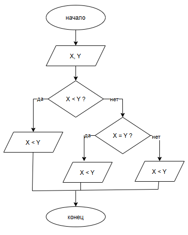

# Лабораторная работа №6 (Вариант 16)
  
Студент: Полякова В.Д.
Группа: бТИИ-261

## Задание

Написать программу, которая выводит результат сравнения двух
введенных пользователем чисел в виде математического выражения (X<Y
или X=Y или X>Y).

**Требуется:**
1. Составить блок-схему алгоритма решения.
2. Написать программу на языке C.

## Блок-схема

